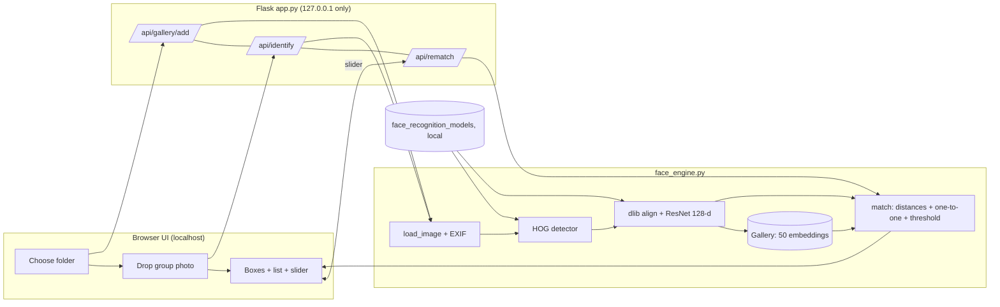

# Architecture

## Diagram
The brief requires the diagram to be generated with **Archify**. Do this in your own AI coding agent
(Claude Code / Cursor / Codex etc.), then save the export here as `architecture.html` (+ a screenshot `architecture.png`):

1. Tell your agent: *Install Archify for me by reading https://raw.githubusercontent.com/tt-a1i/archify/main/llms.txt*
2. Then paste:

> Using Archify, make an **architecture** diagram of this repo: Browser UI (static/index.html: folder picker, drop zone,
> overlay boxes, strictness slider) → Flask server on 127.0.0.1 (app.py: /api/gallery/reset, /api/gallery/add,
> /api/identify, /api/rematch) → face_engine.py (load_image + EXIF fix → HOG face detector → dlib 5-point alignment +
> ResNet 128-d encoder → Gallery of 50 embeddings with SHA-1 cache → match(): distance table + greedy one-to-one
> assignment + threshold → names/Unknown). Show that models come from the local `face_recognition_models` package and
> that nothing crosses the network boundary.

Fallback (renders on GitHub until you add the Archify export):

## Trade-offs
| Chose | Gave up | Why |
|---|---|---|
| dlib embeddings (pip, bundled models) | ~few % accuracy vs ArcFace; weaker on tilted faces | Reliable install and zero downloads on demo day |
| Embedding + nearest neighbour + threshold | Nothing learned from the 50 people | One photo per person; works for any new folder instantly |
| Flask + one static HTML page | Fancy framework features | Judges/office staff need one screen; fewer things to break |
| Threshold 0.50 + live slider | Some true matches become "Unknown" | Wrong names are worse than "Unknown"; slider lets the demo adapt |
| Greedy one-to-one matching | Cannot show the same person twice (e.g. twins/mirror) | A photo has each person once |
| In-memory state, single user | No multi-user server | It is a local laptop demo |
| HOG detector by default | Misses some side-on/small faces | Fast on CPU; CNN available via env var |
